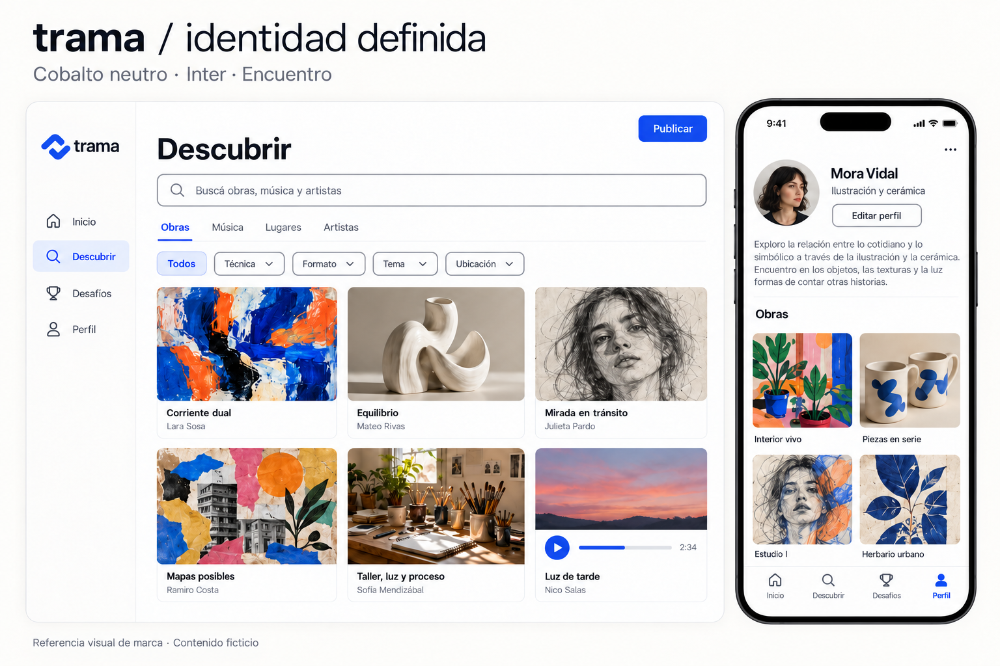

# Trama · Manual de marca y dirección de interfaz

Versión 2.0 · Identidad definida · 27 de octubre de 2026

**Decisiones confirmadas por el propietario:** Trama como identidad de la aplicación, símbolo **11 · Encuentro**, paleta **B · Cobalto neutro** y tipografía **T2 · Inter**. Estas decisiones reemplazan las alternativas de la exploración anterior. Inter se aplica también a títulos y palabra de marca: no se incorpora una segunda familia editorial.

Este documento permite planificar y construir posteriormente el frontend de una red social multidisciplinaria para artistas sin depender de la conversación. Es un manual de identidad y una especificación de diseño, no una aplicación ni una base de sitio. La implementación requiere una autorización posterior.

**Cómo interpretarlo:** la selección de marca está confirmada; las reglas detalladas de composición, navegación, estados y escala son la especificación de diseño derivada de esa selección. Las funciones que no estaban en el archivo original siguen identificadas como propuestas. La elección visual no las convierte automáticamente en requisitos aprobados.

**Jerarquía de referencia:** decisiones confirmadas, valores y reglas escritos, archivo de tokens y, por último, ejemplos visuales. La forma del símbolo procede exclusivamente de 11 Encuentro; ninguna imagen autoriza a rediseñarlo. Los tableros generados pueden aproximar letras o detalles; la fuente Inter incluida y las tablas son la referencia exacta.

El paquete incluye este manual en PDF y Markdown, una ficha de entrega para otra IA, tokens de diseño en JSON, la referencia original del logo elegido, una extracción raster del símbolo, ejemplos actualizados, Inter y su licencia, y el documento de alcance recibido. La extracción raster no sustituye el ajuste y comprobación de un arte maestro vectorial.

## 1 Alcance y lectura del material recibido

Se revisó el archivo **constitutionFrontend 1.txt** y su segunda copia adjunta, cuyo contenido es idéntico. Se revisó también la imagen de referencia con los colores #E3F2FD, #90CAF9, #2196F3 y #0D47A1.

El producto descrito es una red social para artistas: permite compartir dibujos, música, esculturas y otras creaciones; encontrar inspiración mediante filtros; descubrir ubicaciones físicas; explorar música y samples; y participar en desafíos creativos. React es la tecnología indicada. Las pantallas nombradas expresamente son cuestionario, registro, login, home, desafíos, descubrir, perfil y edición de perfil.

Este manual cubre posicionamiento, identidad verbal y visual, la identidad seleccionada y el logo oficial, organización de información, composición de pantallas, comportamiento adaptable, componentes, estados y criterios de aceptación visual. El alcance funcional procede del archivo, mientras que el detalle de presentación es una recomendación de este informe.

### 1.1 Requisitos y propuestas

| Elemento | Origen | Tratamiento en el manual |
| --- | --- | --- |
| Red social multidisciplinaria | Archivo del usuario | Base del posicionamiento y del contenido |
| Ocho pantallas nombradas | Archivo del usuario | Se especifican las ocho |
| React | Archivo del usuario | Se conserva para una futura implementación |
| Filtros, música, samples, lugares y desafíos | Archivo del usuario | Se organizan dentro de la experiencia |
| Likes y recomendaciones basadas en likes | Archivo del usuario | Se contempla su presentación y sus estados |
| Cuatro colores azules | Referencia del usuario | Antecedente; sustituido por Cobalto neutro |
| Manual, ejemplos y logo seleccionado | Pedido del usuario | Entregable de esta etapa |
| Guardados, pestaña Siguiendo y seguir artistas | Propuesta de producto | Requieren confirmar soporte funcional |
| Tema oscuro, publicación detallada y detalle de obra | Propuesta de experiencia | Se documentan como extensiones del flujo |
| PWA instalada o aplicaciones nativas | No definidos | Se prevé diseño móvil; no se da por aprobada su construcción |

### 1.2 Contradicción del documento de origen

El texto se presenta como una constitución del frontend, pero sus puntos 2 a 9 describen sobre todo un servicio de preprocesamiento con entidades de analytics, MySQL, Redis, lotes, TTL y salida para una API Java. El punto 9 incluso define un servicio de background que no expone endpoints de usuario. Esto no es una especificación consistente de una interfaz.

**Interpretación propuesta:** conservar esas reglas como requisitos del servicio de datos y limitar el frontend a presentar resultados y emitir interacciones mediante un contrato acordado. Las clases de rankings, consultas SQL y persistencia Redis no se trasladan al navegador. El frontend no inventará fórmulas de popularidad ni porcentajes de afinidad. Los límites de 100.000 publicaciones y 10.000 usuarios activos son objetivos del sistema citado, no una justificación para cargar todo el catálogo en el cliente.

El manual no modifica el archivo original. Antes de implementar, conviene separar la constitución de frontend de la del servicio de procesamiento y acordar los datos que la API entrega. La planificación y las muestras visuales sí pueden completarse con la información disponible.

## 2 Método de investigación y límites

Se consultaron fuentes oficiales públicas de seis productos comparables, documentación de accesibilidad del W3C, documentación de Inter, la documentación de Material UI y referencias de plataforma de MDN. Las fuentes se enumeran al final con enlaces y fecha de consulta. Se evita basar decisiones en listados comerciales de tendencias.

**Evidencia:** funciones descritas por sus propios proveedores y requisitos publicados. **Interpretación:** lo que esas referencias sugieren para este producto. **Propuesta:** elecciones de marca, navegación, tamaños y composición. Se indican estos niveles en los apartados relevantes.

No se realizaron entrevistas, pruebas con usuarios, un estudio exhaustivo del mercado, una auditoría de cuentas privadas ni una evaluación de la aplicación existente. Las muestras son diseños originales conceptuales generados para esta identidad; no son capturas de una app funcionando. El uso de Trama está elegido para esta identidad; la disponibilidad registral y de dominios no se ha verificado. Las tipografías de las imágenes generadas pueden ser aproximadas: las familias y medidas escritas en este manual son la referencia exacta.

## 3 Producto y posicionamiento

**Propuesta de posicionamiento:** una comunidad para descubrir obras, entender qué las inspira y encontrar un estímulo concreto para crear algo propio. Su identidad debe dar el mismo lugar a una imagen, una pieza sonora y una obra física documentada mediante fotografías.

La combinación de disciplinas y ubicaciones es una oportunidad de diseño, no una ventaja competitiva validada. El producto necesita demostrar que relacionar esas fuentes aporta más valor que mantenerlas en aplicaciones separadas.

### 3.1 Públicos a validar

| Perfil hipotético | Necesidad | Consecuencia para la interfaz |
| --- | --- | --- |
| Persona que comienza a crear | Referencias claras y participación sin intimidación | Lenguaje sencillo, perfiles sin ostentación de métricas |
| Artista con práctica habitual | Compartir obra y proceso con contexto | Autor visible, galería cuidada, descripción accesible |
| Músico o productor | Escuchar referencias y explorar samples | Reproductor reconocible y metadatos pertinentes |
| Explorador cultural | Encontrar espacios relacionados con intereses | Lista de lugares y mapa secundario accesible |

Estas categorías son hipótesis; no se les asignan edades, ingresos ni cuotas de mercado inventadas.

### 3.2 Principios de marca

**La obra lleva el protagonismo.** El color de la interfaz debe acompañar sin teñir las fotografías. **El contexto importa.** Nombre de la obra, autor y disciplina se mantienen cerca del contenido. **La participación es accesible.** Los desafíos invitan a probar, sin transmitir que solo el trabajo profesional merece mostrarse. **La interfaz es predecible.** Acciones, radios y espaciados se repiten de forma consistente.

Como pauta de composición, la estructura de la interfaz será mayormente neutral y el cobalto ocupará una parte pequeña: acciones, selección, enlaces y marca. No se exige llenar una cuota de color. Es una pauta de diseño, no una proporción calculada sobre las obras subidas por usuarios.

## 4 Competencia y referencias de producto

Esta comparación analiza capacidades documentadas, no popularidad, facturación ni la totalidad de cada plataforma. No se interpreta la ausencia de una función en una fuente como prueba de que el competidor no la ofrece.

| Referencia | Evidencia pública | Aprendizaje aplicable | Adaptación propuesta |
| --- | --- | --- | --- |
| Behance | Feed, exploración curada y búsquedas con filtros por disciplina, herramientas, color o ubicación [F1] | Separar consumo habitual de búsqueda intencional | Inicio para feed; Descubrir para filtros y exploración |
| Pinterest | Descubrimiento visual y organización de Pins en tableros [F2] | Ver y guardar responden a necesidades distintas | Un guardado no debe confundirse con un like |
| Are.na | Colecciones, conexiones entre contenidos y canales colaborativos [F3] | El contexto compartido también produce descubrimiento | Referencias e inspiración con autoría identificable |
| DeviantArt | Comunidad, obras destacadas y desafíos oficiales [F4] | Un desafío necesita consigna y reglas claras | Pantalla propia con estado y forma de participar |
| BandLab | Creación musical, colaboración y funciones sociales [F5] | El audio requiere interacción específica | Tarjeta sonora con reproducción; no simular una estación de producción |
| ArtStation | Portfolios y perfil social para descubrimiento [F6] | Perfil y feed cumplen tareas diferentes | Perfil como archivo de obra, con datos sociales en segundo plano |

**Interpretación para esta app:** combinar el cuidado de portfolio de Behance y ArtStation, la exploración de Pinterest, el contexto de Are.na y una representación de audio inspirada en las necesidades que atiende BandLab. Copiar la apariencia completa de cualquiera de ellos reduciría la identidad propia y podría introducir funciones fuera del alcance.

No recomiendo un home dominado por un carrusel promocional, un gran mensaje de bienvenida repetido o indicadores estadísticos. El contenido debe aparecer pronto. El desafío vigente puede tener un bloque compacto; su exploración completa corresponde a Desafíos. Esta es una decisión de jerarquía propuesta, no una conclusión de un experimento de conversión.

**Riesgo de producto:** mezclar imágenes, audio, samples y lugares en una sola grilla sin jerarquía puede volver confusa la búsqueda. La solución propuesta es mantener filtros por tipo de contenido y adaptar la tarjeta a cada medio, con un lenguaje visual compartido.

## 5 Evaluación de la paleta original

Los cuatro valores coinciden con Blue 50, 200, 500 y 900 de la paleta Material publicada por MUI [F7]. La selección tiene continuidad tonal y permite construir una jerarquía simple. Mi valoración es que resulta limpia y familiar, aunque usada sin ajustes se parece a una interfaz de plantilla y no comunica por sí sola una comunidad artística.

| Color aportado | Papel que le daría | Cambio recomendado |
| --- | --- | --- |
| #E3F2FD | Fondo de selección o bloque informativo | No cubrir toda la aplicación de celeste |
| #90CAF9 | Apoyo gráfico y acento en tema oscuro | Usar texto oscuro encima; evitarlo para texto sobre blanco |
| #2196F3 | Acento visual, gráficos decorativos | Oscurecerlo para botones con etiqueta blanca pequeña |
| #0D47A1 | Azul profundo, texto destacado y estados activos | Reservarlo para contrastes fuertes; sumar neutrales |

### 5.1 Contraste comprobado

Cálculo propio mediante luminancia relativa sRGB y la fórmula (L mayor + 0,05) / (L menor + 0,05). Se evaluaron colores sólidos sin transparencia; se muestran valores redondeados a dos decimales. El objetivo AA para texto normal es 4,5:1, y para texto grande es 3:1 [F8]. El tamaño grande se refiere, aproximadamente, a 24 CSS px regular o 18,67 CSS px en negrita, no a cualquier título.

| Texto | Fondo | Contraste | Uso |
| --- | --- | --- | --- |
| Blanco #FFFFFF | #E3F2FD | 1,14:1 | No apto para texto informativo |
| Blanco #FFFFFF | #90CAF9 | 1,75:1 | No apto para texto informativo |
| Blanco #FFFFFF | #2196F3 | 3,12:1 | No cumple AA para texto normal |
| Blanco #FFFFFF | #0D47A1 | 8,63:1 | Apto para texto normal |
| Tinta #172338 | #2196F3 | 5,04:1 | Alternativa válida conservando el azul |
| Blanco #FFFFFF | #1565C0 | 5,75:1 | Alternativa evaluada, no seleccionada |
| Blanco #FFFFFF | #2447D8 | 7,08:1 | Cobalto seleccionado para botones |

**Conclusión de diseño:** no hace falta abandonar el azul. Sí hace falta asignar roles, completar la escala neutral y evitar combinaciones de bajo contraste. Un color atractivo como muestra aislada puede no funcionar para un botón de 16 px.

## 6 Identidad seleccionada: Cobalto neutro + Inter

La dirección final combina azul cobalto, fondos casi blancos y una sola familia tipográfica. La personalidad nace del símbolo, la composición y las obras; no necesita un segundo color decorativo permanente.

| Elemento | Decisión final | Función |
| --- | --- | --- |
| Marca | Trama; palabra de marca en minúsculas | Identidad de la comunidad |
| Símbolo | 11 Encuentro | Conexión entre disciplinas e ideas |
| Cobalto | #2447D8 | Acciones, enlaces, selección y marca |
| Fondo | #FAF9F6 | Lienzo casi blanco, levemente cálido |
| Superficie | #FFFFFF | Paneles, campos y tarjetas cuando haga falta |
| Tinta | #202327 | Texto principal y versión monocroma del logo |
| Selección | #E8EDFF | Apoyo a estados activos |
| Tipografía | Inter | Títulos, cuerpo, navegación, controles y marca |

### 6.1 Qué cambia respecto de la exploración

Se reemplaza el marfil marcado por #FAF9F6, se retira el coral editorial y los títulos pasan a Inter. Encuentro sustituye todos los símbolos anteriores. Las otras paletas y familias exploradas dejan de ser alternativas activas.

Inter produce una voz neutral y uniforme. El símbolo, las proporciones, el espacio entre piezas y el tratamiento específico de imágenes y audio aportan identidad. No se añaden degradados ni adornos para compensar esa neutralidad.

### 6.2 Distribución del color

El fondo de página es #FAF9F6; los paneles usan blanco. El cobalto identifica acciones principales, enlaces y selección. La selección también necesita texto, una marca o una línea; el fondo suave por sí solo es insuficiente.

Las obras conservan sus colores. Éxito, error y advertencia son colores funcionales. El tema oscuro adapta el mismo sistema y queda documentado como extensión opcional.

## 7 Nombre e identidad verbal

**Trama** permite hablar de relaciones entre disciplinas, personas e ideas. El símbolo no depende de una sola disciplina artística. En el logotipo se usa la palabra en minúsculas, con una presencia discreta frente a las obras.

El nombre usado por el producto es **Trama**; la palabra de marca es **trama**. En textos corridos se escribe Trama, con mayúscula inicial. La elección de identidad no implica una comprobación registral ni de disponibilidad de dominios.

**Descriptor recomendado:** Comunidad para artistas. **Línea de comunicación opcional:** Encontrá ideas. Compartí lo que creás. No debe ocupar de forma permanente el espacio principal del feed.

El tono propuesto es cercano, concreto y respetuoso del proceso. Para la primera versión en español rioplatense se usa voseo coherente: explorá, compartí, elegí, guardá. Los rótulos funcionales pueden quedar en infinitivo: Publicar, Guardar, Editar perfil. No alternar vos, tú y usted sin una estrategia de localización.

| Situación | Ejemplo recomendado |
| --- | --- |
| Cuestionario | ¿Qué te inspira? Podés cambiarlo después. |
| Feed vacío | Todavía no hay obras para mostrar. Explorá otras disciplinas. |
| Error de carga | No pudimos cargar las obras. Volvé a intentar. |
| Guardado confirmado | Obra guardada. |
| Cambios de perfil | Tu perfil se actualizó. |
| Audio no disponible | Este audio no se puede reproducir ahora. |
| Ubicación opcional | Elegí una zona o usá tu ubicación. |

Evitar promesas no demostradas como “los mejores artistas”, mensajes de culpa por no participar y cifras simuladas que parezcan actividad real. Las muestras usan autores, títulos y obras ficticios para ilustrar el diseño.

## 8 Logo oficial: 11 Encuentro

El propietario seleccionó expresamente el logo 11 de la lámina de formas esenciales. Su forma está compuesta por dos bandas gruesas, angulares y suavemente redondeadas, separadas por un vacío abierto y dispuestas en diagonal. La lectura propuesta es encuentro y relación entre partes. Esta interpretación conceptual no modifica la forma seleccionada.

La lámina original completa se entrega como **assets/referencia_11_original.png**. La opción válida está en la fila inferior, columna central, bajo el rótulo 11 Encuentro. Las otras cinco opciones de esa lámina son antecedentes y no forman parte de la identidad vigente. La imagen aislada es una extracción raster de apoyo; ante una diferencia de contorno, prevalece la opción 11 de la referencia original.

### 8.1 Composición con la palabra de marca

Versión principal: símbolo a la izquierda y **trama** a la derecha, en Inter 600, minúsculas, sin punto ni descriptor permanente. El conjunto es horizontal, con alineación óptica vertical. La palabra conserva las formas estándar de Inter; no reemplazar letras por el símbolo ni inventar ligaduras.

Regla base para producir el arte maestro: altura visible del símbolo H; cuerpo tipográfico nominal de la palabra 0,90H; espacio símbolo-palabra 0,25H; tracking inicial de la palabra -0,025em. La palabra se centra por sus límites visuales, no por la caja de línea. Estas proporciones son un punto de partida explícito para el ajuste óptico vectorial; una vez aprobado ese archivo, se escala el conjunto como unidad.

Ejemplo en cabecera: H = 32 px, palabra a 28,8 px y espacio de 8 px. En un icono o un avatar se usa solo el símbolo. No se añade la palabra dentro de un cuadrado de app ni se vuelve a componer cada instancia con espaciados diferentes.

### 8.2 Zona de protección y tamaños

Definir u = H/4. La zona libre mínima alrededor del símbolo o del conjunto horizontal es u, medida desde su contorno visible, sin contar el padding transparente del archivo. No introducir texto, bordes, otras marcas o recortes dentro de esa zona.

Símbolo aislado: objetivo mínimo 24 CSS px; uso habitual de cabecera 32 px. Conjunto horizontal: ancho inicial mínimo 104 CSS px, sujeto a verificación del arte maestro. Para un favicon de 16 px se reduce el mismo símbolo y se revisa el vacío interior; si pierde claridad, se ajusta técnicamente a la grilla sin introducir un símbolo nuevo. Estos mínimos son objetivos de producción, no pruebas de legibilidad ya realizadas sobre un SVG.

### 8.3 Versiones de color

| Versión | Símbolo | Palabra | Fondo |
| --- | --- | --- | --- |
| Principal claro | #2447D8 | #202327 | Blanco o #FAF9F6 |
| Una tinta cobalto | #2447D8 | #2447D8 | Blanco o #FAF9F6 |
| Monocroma oscura | #202327 | #202327 | Claro |
| Negativa | #FFFFFF | #FFFFFF | #2447D8 o fondo oscuro uniforme |
| Compacta de producto | Blanco | No aplica | Cobalto con margen amplio |

Usar color plano. No aplicar degradados, volumen, contornos, sombras o dos tintas para simular entrelazado. No estirar, espejar, rotar ni cerrar la separación entre bandas. No sustituirlo por un eslabón genérico o una X. Sobre una fotografía, usar una superficie uniforme que asegure visibilidad y proteja la obra.

El fondo redondeado que agrega una plataforma a un icono no forma parte del símbolo. No recortar el signo para llenar un avatar; mantenerlo centrado y respetar su área libre.

### 8.4 Estado del arte de marca

La elección del símbolo es definitiva para esta etapa. El paquete entrega referencia original y extracción PNG transparente; no declara que exista un SVG maestro validado. La tarea pendiente es vectorizar fielmente esa forma, ajustar el conjunto con Inter y revisar tamaños pequeños y versiones monocromas. No implica volver a elegir logo.

El paquete de producción deberá contener SVG horizontal y compacto, versiones cobalto, tinta y blanca, PNG transparentes y tamaños de icono según la plataforma finalmente aprobada. La IA que implemente debe reutilizar el recurso validado; no generar un logo diferente en cada pantalla ni convertir el fondo de una imagen de ejemplo en parte del símbolo.

## 9 Sistema de color

Los valores siguientes desarrollan Cobalto neutro. Los nombres de rol se mantienen entre temas; su valor puede cambiar. Los tokens entregados en **TOKENS_TRAMA.json** son datos de especificación, no una implementación de componentes. Los colores son sRGB sólidos, sin transparencia salvo que se indique.

### 9.1 Tema claro principal

| Rol | Valor | Aplicación |
| --- | --- | --- |
| Fondo general | #FAF9F6 | Lienzo de la app |
| Superficie base | #FFFFFF | Paneles, campos, menús y tarjetas |
| Superficie tenue | #F1F2F4 | Grupos secundarios y carga estática |
| Texto principal | #202327 | Títulos, cuerpo y etiquetas |
| Texto secundario | #62666D | Metadatos, ayuda y placeholder |
| Separador decorativo | #DEDFE3 | Divisiones sin función de control |
| Borde de control | #82858B | Campos y controles que necesitan contorno |
| Acción principal | #2447D8 | Botón principal, enlaces y foco |
| Acción hover | #1C37B0 | Respuesta al puntero |
| Acción presionada | #182F96 | Respuesta durante activación |
| Texto sobre acción | #FFFFFF | Etiquetas de botones principales |
| Selección suave | #E8EDFF | Filtro o fila activa |
| Texto en selección | #2447D8 | Texto, marca e indicador activo |
| Fondo deshabilitado | #E7E8EB | Acciones temporalmente no disponibles |
| Texto deshabilitado | #777A80 | Solo componentes inactivos |
| Éxito | #18734F | Estado confirmado, acompañado de texto |
| Fondo de éxito | #E7F4EC | Aviso de confirmación |
| Error | #B42338 | Error, borde de error y acción destructiva |
| Fondo de error | #FDECEF | Aviso de error |
| Advertencia | #7A4D00 | Texto e icono de atención |
| Fondo de advertencia | #FFF3D6 | Aviso de atención |

Los separadores suaves no identifican por sí solos un campo: ese caso usa el borde de control. Un botón de texto con nombre claro puede prescindir de contorno. No utilizar el estilo deshabilitado para información normal, ni comunicar un error solo cambiando el borde a rojo.

### 9.2 Tema oscuro como extensión

| Rol | Valor | Aplicación |
| --- | --- | --- |
| Fondo general | #17191D | Lienzo oscuro neutral |
| Superficie base | #21242A | Tarjetas, campos y paneles |
| Superficie tenue o elevada | #2A2E36 | Grupos secundarios y superposiciones |
| Texto principal | #F3F2EE | Contenido principal |
| Texto secundario | #BBC1CD | Ayuda y metadatos |
| Separador decorativo | #3B414B | Divisiones no interactivas |
| Borde de control | #777E8C | Contornos necesarios |
| Acción principal | #A9BAFF | Botones, enlaces y foco |
| Acción hover | #C3CEFF | Respuesta al puntero |
| Acción presionada | #91A6F5 | Respuesta durante activación |
| Texto sobre acción | #17191D | Etiqueta del botón principal |
| Selección suave | #29345C | Filtro o fila activa |
| Texto en selección | #A9BAFF | Texto e indicador seleccionado |
| Fondo deshabilitado | #343840 | Acción inactiva |
| Texto deshabilitado | #858B96 | Solo componentes inactivos |
| Éxito | #89DCB3 | Estado positivo |
| Fondo de éxito | #183A2B | Aviso de confirmación |
| Error | #FFB4BC | Estado de error |
| Fondo de error | #48272D | Aviso de error |
| Advertencia | #F2D28E | Atención |
| Fondo de advertencia | #41351C | Aviso de atención |

La marca conserva el cobalto de identidad, pero las acciones sobre fondos oscuros necesitan el azul claro funcional. Para la marca en cabecera oscura se utiliza la versión blanca. No invertir ni teñir obras para acomodarlas al tema.

El tema claro es la referencia principal. Si se habilita oscuro, la preferencia ofrecerá Claro, Oscuro y Sistema, respetando una selección explícita. La selección de B no autoriza por sí sola a ampliar el alcance funcional a tema oscuro.

### 9.3 Contraste medido

Los valores se calculan con luminancia relativa sRGB. Se muestran redondeados, pero el cumplimiento se decide con el valor sin redondear. Objetivos: 4,5:1 para texto normal y 3:1 para información gráfica o contornos necesarios [F8, F9].

| Primer plano | Fondo | Contraste | Aplicación |
| --- | --- | --- | --- |
| #202327 | #FAF9F6 | 14.98:1 | Texto principal claro |
| #62666D | #FAF9F6 | 5.48:1 | Texto secundario claro |
| #62666D | #FFFFFF | 5.77:1 | Ayuda sobre panel blanco |
| #2447D8 | #FAF9F6 | 6.72:1 | Enlace sobre fondo |
| #FFFFFF | #2447D8 | 7.08:1 | Botón principal |
| #FFFFFF | #1C37B0 | 9.45:1 | Botón hover |
| #FFFFFF | #182F96 | 11.14:1 | Botón presionado |
| #2447D8 | #E8EDFF | 6.06:1 | Texto seleccionado |
| #82858B | #FFFFFF | 3.70:1 | Contorno sobre campo |
| #82858B | #FAF9F6 | 3.51:1 | Contorno sobre lienzo |
| #18734F | #E7F4EC | 5.15:1 | Texto de éxito |
| #B42338 | #FDECEF | 5.69:1 | Texto de error |
| #7A4D00 | #FFF3D6 | 6.59:1 | Texto de advertencia |
| #F3F2EE | #17191D | 15.71:1 | Texto principal oscuro |
| #BBC1CD | #21242A | 8.61:1 | Texto secundario oscuro |
| #17191D | #A9BAFF | 9.35:1 | Botón oscuro |
| #A9BAFF | #29345C | 6.41:1 | Texto seleccionado oscuro |
| #777E8C | #2A2E36 | 3.34:1 | Contorno en superficie elevada |

La selección suave no funciona como único indicador. Usar también marca, texto y/o contorno de cobalto. El enlace dentro de un párrafo se subraya, no se distingue solo por color. La paleta no certifica accesibilidad: transparencias, estados, imágenes y la interfaz final requieren revisión.

## 10 Tipografía oficial: Inter

**Inter es la única familia tipográfica de Trama.** Se utiliza en la palabra de marca, títulos, cuerpo, controles, navegación y metadatos. Su proyecto documenta variantes ópticas para texto y display y funciones como números tabulares [F10]. La jerarquía se construye mediante tamaño, peso, espacio y contraste.

Pesos del sistema: 400 Regular para lectura; 500 Medium para controles y navegación; 600 Semibold para subtítulos, títulos de tarjeta y palabra de marca; 700 Bold para títulos principales. No usar peso 300 en contenido habitual ni negrita en todos los bloques.

### 10.1 Escala tipográfica

Tamaños en CSS px; la altura de línea es una referencia de lectura, no una altura fija de contenedor. Usar unidades relativas al implementar. El archivo JSON expresa la misma escala. Un título promocional destacado es para piezas de marca; no obliga a crear un hero grande en el feed.

| Estilo | Familia y peso | Móvil tamaño / línea | Escritorio tamaño / línea |
| --- | --- | --- | --- |
| Destacado de marca | Inter 700 | 32 / 38 | 48 / 56 |
| Título de página | Inter 700 | 28 / 34 | 36 / 44 |
| Título de sección | Inter 600 | 22 / 29 | 24 / 32 |
| Título de tarjeta | Inter 600 | 18 / 25 | 18 / 25 |
| Texto principal | Inter 400 | 16 / 24 | 16 / 24 |
| Botón y campo | Inter 500 | 16 / 24 | 16 / 24 |
| Ayuda y metadatos | Inter 400 | 14 / 20 | 14 / 20 |
| Navegación breve | Inter 500 | 12 / 16 | 14 / 20 |

Tracking: -0,025em en destacado, -0,02em en título de página, -0,01em en títulos de sección y 0 en cuerpo, controles y metadatos. La palabra de marca usa su ajuste indicado en el capítulo 8. No comprimir letras para acomodar textos que deben envolver a una segunda línea.

### 10.2 Reglas de lectura

Las etiquetas de 12 px se limitan a navegación breve. Ayudas, errores y datos esenciales no bajan de 14 px. El ancho deseable de un párrafo largo es 55 a 75 caracteres. Los nombres de obras pueden ocupar dos líneas y deben poder consultarse completos; no truncar mensajes de error ni instrucciones.

Mantener tildes, signos iniciales y eñe: “Ilustración”, “Música”, “Diseño”, “¿Qué te inspira?”, “ÁÉÍÓÚ ñ”. Duraciones, fechas alineadas y progreso pueden usar números tabulares. No usar todo en mayúsculas para botones o párrafos. Respetar el aumento de tamaño de texto y el zoom sin recortar controles.

### 10.3 Archivos y licencia

El paquete incluye el archivo variable de Inter y su licencia SIL Open Font License, obtenidos del repositorio oficial de Google Fonts, junto con procedencia y huella SHA-256. La fuente no se modifica en el paquete. Conservar los avisos de licencia al redistribuirla. Para web puede prepararse una versión WOFF2 de la misma distribución; no cargar familias alternativas que no se usan.

Si Inter todavía no está disponible, usar temporalmente system-ui y sans-serif. La referencia final sigue siendo Inter; revisar que la carga no altere de forma grave el ancho de controles o la composición. Las muestras tipográficas del PDF están compuestas con archivos reales de Inter, a diferencia de las aproximaciones posibles en imágenes generadas.

## 11 Geometría composición y movimiento

La interfaz tendrá una geometría consistente: controles con radio de 10 px; tarjetas de 12 px; paneles superpuestos de 16 px; avatares circulares. Filtros y buscadores utilizan el mismo radio de controles. La cápsula completamente redonda se reserva para insignias muy breves y no se mezcla arbitrariamente con campos rectangulares.

La escala de espacios será 4, 8, 12, 16, 24, 32, 48 y 64 px. En móvil se usarán 16 px de margen lateral, 12 px entre tarjetas y 24 o 32 px entre grupos. En escritorio, 24 o 32 px de separación entre bloques principales. Una sección no necesita una caja de color para estar diferenciada: puede hacerlo mediante título y espacio.

Se priorizan fondos planos y bordes finos. Las sombras se reservan para menús, diálogos o un elemento realmente superpuesto. No se recomienda un brillo permanente en la navegación activa. El estado se comunica con color, peso tipográfico y un indicador reconocible, como una línea o marca.

**Movimiento propuesto:** 120 a 160 ms para respuesta de botones; 180 a 220 ms para abrir paneles; desplazamientos de 4 a 8 px como máximo cuando ayuden a interpretar la transición. Son parámetros de diseño, no requisitos de una biblioteca. Respetar la preferencia de movimiento reducido documentada por MDN [F14]. No agregar parallax o animaciones de entrada a cada obra del feed.

### 11.1 Grilla adaptable

| Ancho de referencia | Navegación | Contenido |
| --- | --- | --- |
| 320 a 359 px | Inferior con cuatro destinos | Una columna si texto o controles no caben |
| 360 a 767 px | Inferior | Feed de una columna; Descubrir hasta dos columnas |
| 768 a 1023 px | Barra lateral compacta con etiquetas accesibles | Dos o tres columnas según tarjeta |
| 1024 px o más | Barra lateral de 208 px | Área principal con tres o cuatro columnas |
| 1440 px o más | Misma estructura | Contenedor centrado, ancho máximo propuesto de 1440 px |

Los puntos de cambio responden al espacio útil, no a modelos de teléfono. Después de descontar navegación y márgenes, las columnas se ajustan al contenido. Las imágenes de Descubrir pueden usar proporciones variables con un orden de lectura estable. El feed mixto prioriza tarjetas alineadas y lectura secuencial. Evitar un masonry que cambie visualmente el orden respecto del teclado.

## 12 Arquitectura de información

Se proponen **cuatro destinos principales**: Inicio, Descubrir, Desafíos y Perfil. Publicar es una acción independiente visible en la cabecera, con etiqueta en escritorio y un botón con nombre accesible en móvil. El flujo exacto de publicación debe confirmarse porque el archivo nombra compartir obras, pero no enumera una pantalla de creación.

| Área | Contenido | Acceso secundario |
| --- | --- | --- |
| Inicio | Feed de obras y actividad pertinente | Para vos; Siguiendo si existe seguimiento |
| Descubrir | Obras, Música, Lugares, Artistas | Búsqueda, filtros, detalle y reproducción |
| Desafíos | Consignas y estado de participación | Detalle y obras participantes |
| Perfil | Identidad y obras del usuario | Editar perfil; Guardados si se aprueba |
| Acceso | Registro e ingreso | Recuperación de acceso según sistema real |
| Cuestionario | Preferencias iniciales | Omitir y editar más adelante, propuesto |

Las muestras visuales muestran algunos subconjuntos de pestañas por espacio; la tabla es el mapa propuesto completo. Guardados personales no deben aparecer en un perfil ajeno salvo una política explícita que permita hacerlos públicos.

**Flujo inicial propuesto:** Registro, cuestionario breve y luego Inicio. **Flujo recurrente:** Ingreso y regreso al destino solicitado cuando corresponda. **Descubrimiento:** búsqueda o filtro, detalle, interacción y regreso conservando posición y filtros. **Desafío:** leer consigna, consultar condiciones y elegir una obra o iniciar publicación según lo que el producto permita.

## 13 Especificación de las ocho pantallas

Las ocho pantallas siguientes pertenecen al alcance del archivo. Sus campos y comportamientos detallados son propuestas para completar ese alcance. En cada una se contemplan carga, resultado vacío y error cuando sean pertinentes.

### 13.1 Cuestionario

**Objetivo:** conseguir una primera selección de intereses sin convertirla en una barrera. Se proponen dos pasos: disciplinas de interés y tipos de inspiración. La ubicación se solicita dentro de Lugares cuando se necesite, no durante el registro por defecto.

Composición: título “¿Qué te inspira?”, una frase de explicación, opciones con texto e icono, indicador “Paso 1 de 2”, botón Continuar y acción Omitir. El progreso debe ser textual además de gráfico. Proponer entre 6 y 8 disciplinas iniciales, permitir selección múltiple y ofrecer opciones más amplias que “dibujo”. No exigir un mínimo arbitrario sin evidencia de que el sistema lo necesita.

Estados: sin selección, seleccionada, error al guardar y finalización. La opción activa combina borde cobalto, fondo suave y marca de verificación. Se puede volver al paso anterior sin perder elecciones. Las recomendaciones de arranque pueden ser generales si no hay intereses; no atribuir una afinidad personalizada inexistente.

### 13.2 Registro

**Objetivo:** crear una cuenta y explicar brevemente qué ofrece la comunidad. Formulario de una columna, ancho máximo 420 px, etiquetas visibles, texto de ayuda y enlace hacia ingreso.

Campos propuestos para autenticar con contraseña: nombre visible, correo y contraseña. El identificador público puede elegirse después si el backend lo permite. El diseño real debe adaptarse al contrato de autenticación existente. Mostrar requisitos de contraseña antes de enviar, permitir mostrar u ocultar y conservar datos no sensibles si ocurre un error.

En escritorio amplio puede existir una composición de obra con crédito al costado; en móvil el formulario va primero. La altura se adapta al contenido y al teclado. No forzar una relación de aspecto fija ni introducir un gran fondo de color detrás de cada campo. Incluir aceptación o enlaces de políticas solo con textos y requisitos aprobados por el producto.

### 13.3 Ingreso

**Objetivo:** entrar rápido y retomar la actividad. Comparte proporciones, bordes y tipografía con Registro. Título “Ingresar”, correo y contraseña cuando correspondan, acción principal Ingresar y enlaces a recuperación y registro.

Estados: normal, validando, credenciales rechazadas, conexión fallida y éxito. El estado de carga mantiene el ancho del botón para evitar saltos. Los mensajes deben ser accionables y coherentes con el sistema de autenticación; no inventar detalles internos. Permitir pegar contraseñas y usar gestores, coherente con las pautas de autenticación accesible [F8]. Los proveedores externos se muestran únicamente si están disponibles.

### 13.4 Inicio

**Objetivo:** ver creaciones con rapidez. Cabecera compacta, acceso a publicar, pestañas Para vos y Siguiendo si se habilita seguimiento, seguidas por tarjetas del feed. Propuesta de ancho de lectura del feed: 640 a 720 px en escritorio y todo el ancho útil en móvil.

Cada publicación muestra autor, contenido, título si existe, descripción expandible y acciones autorizadas. El contenido visual conserva su proporción; si se usa miniatura recortada, el detalle ofrece la obra completa. Las publicaciones de audio llevan controles propios, no una imagen que parece reproducible pero no responde.

Un bloque de desafío puede aparecer entre grupos de contenido con título, resumen y Ver consigna. No impone una altura de portada ni reproduce una animación. En un feed nuevo se muestra una explicación y acceso a Descubrir; no se inventan obras de usuarios reales. Ante un error parcial se conserva lo ya cargado y se ofrece reintentar.

### 13.5 Desafíos

**Objetivo:** entender qué crear y cómo participar. Encabezado, categorías de estado cuando existan y tarjetas con título, disciplina o alcance, resumen, fecha real y acción Ver consigna.

El detalle debe explicar consigna, formatos aceptados, condiciones, fecha con zona horaria y criterio de selección si existe. Proponer estados Próximo, Abierto y Finalizado, siempre respaldados por datos. Los estados visuales no dependen únicamente del color. Un desafío terminado conserva la consigna y sus obras, si la política del producto lo permite.

Evitar rankings, premios, jurados, votos o temporizadores que no estén definidos. “Crear con una sola línea” es contenido ficticio usado en la muestra. El botón de participación puede llevar a elegir una publicación o crear una nueva, pero no se simula una inscripción completada sin confirmación del sistema.

### 13.6 Descubrir

**Objetivo:** pasar de una intención amplia a una referencia relevante. Encabezado, buscador y selector de tipo: Obras, Música, Lugares y Artistas. Cambiar tipo actualiza los filtros pertinentes, manteniendo visible qué se está buscando.

Para Obras se proponen disciplina, técnica y orden soportado. Un filtro por color se incorpora solo si existen datos o procesamiento para sostenerlo. Para Música se propone separar canciones y samples; género, duración, BPM o tonalidad se muestran únicamente si están disponibles y son confiables. Para Lugares se usa ciudad o zona como alternativa a geolocalización. Se recomienda lista antes que mapa en móvil, con opción de alternar.

En móvil, Filtros abre un panel con título, selección actual, Limpiar y Mostrar resultados. En escritorio puede ser un panel lateral o un menú amplio según la cantidad. Indicar el número de filtros activos; no fabricar un número de resultados mientras no se conozca. Un vacío ofrece quitar filtros conservando el texto de búsqueda.

La licencia de un sample no se deduce de que pueda escucharse. Mostrar “Licencia no informada” cuando corresponda y no habilitar “Usar libremente” por inferencia. El descubrimiento de lugares tampoco presupone que puedan agregarse, reseñarse o reservarse desde esta versión.

### 13.7 Perfil

**Objetivo:** entender quién crea y explorar su obra. Cabecera con avatar, nombre visible, identificador cuando exista, disciplinas, biografía y enlaces pertinentes. La biografía se ubica directamente sobre el fondo de página; no necesita un recuadro de color.

En perfil propio: Editar perfil y acción Publicar. En perfil ajeno: Seguir únicamente si se aprueba esa función. Propuesta de pestañas para el propio: Obras y Guardados; en el ajeno, Obras y otras colecciones explícitamente públicas. Los contadores reales pueden ser secundarios; no deben competir con la galería.

Estados: sin obras, perfil incompleto, contenido restringido, usuario no disponible y error de carga. La galería mantiene el mismo sistema de tarjetas de Descubrir. Si una biografía es larga, se expande con una acción clara en lugar de desplazar toda la obra fuera del primer recorrido.

### 13.8 Editar perfil

**Objetivo:** modificar datos sin perder el contexto personal. Se propone una página integrada con título y regreso al perfil, no un modal decorativo que parezca ajeno al resto de la app. Ancho máximo del formulario: 640 px.

Orden propuesto: imagen y recorte, nombre, identificador público si es editable, biografía, disciplinas, enlaces y ubicación pública opcional. Explicar qué será público junto al campo correspondiente. No mezclar correo, contraseña y datos privados dentro de la sección de presentación artística.

Botones Guardar cambios y Cancelar, con jerarquía consistente. Mostrar errores cerca del campo y resumen si son varios. Mantener los cambios ante un fallo de red. Avisar antes de abandonar si hay cambios sin guardar, siempre ofreciendo una salida. En móvil, si la barra de acciones es fija, se reserva su altura en el contenido para que no tape el último campo.

## 14 Ejemplos de aplicación visual

El ejemplo aplica la identidad seleccionada a Descubrir en escritorio y Perfil en móvil. Se observa el cobalto concentrado en acción y selección, fondos claros, títulos sans serif y obras con su propio color. El logo corresponde al símbolo 11; la referencia original prevalece si el render introduce alguna diferencia.

Los nombres, títulos y obras son ficticios. Es una muestra conceptual de jerarquía y estilo, no una aplicación funcionando ni una prueba responsive. No se extraen medidas ni códigos de color de sus píxeles; se usan los valores escritos en este manual.

En implementación, todos los textos y controles deben ser elementos reales de interfaz. La imagen no se convierte en un fondo clicable. Se conserva la estructura de cuatro destinos, Publicar como acción separada y las reglas de contenido de cada pantalla, incluso si un detalle menor de la muestra no las representa perfectamente.

## 15 Componentes y estados

La siguiente tabla define piezas compartidas. Son especificaciones para la futura interfaz, no componentes ya desarrollados.

| Componente | Regla visual y de contenido | Estados mínimos |
| --- | --- | --- |
| Botón primario | Alto mínimo 44 px; radio 10; texto de 16 px; una acción principal por grupo | Normal, hover, foco, presionado, cargando, deshabilitado |
| Botón secundario | Superficie neutral, borde de control; misma geometría | Mismos estados pertinentes |
| Campo | Alto mínimo 48 px; etiqueta fuera del campo; ayuda debajo | Vacío, escrito, foco, error, deshabilitado, solo lectura |
| Buscador | Misma familia del campo; lupa, texto y limpiar cuando haya contenido | Espera, buscando, resultados, vacío, error |
| Filtro | Texto breve y marca de selección; cuenta activa cuando corresponda | Inactivo, seleccionado, foco, no disponible |
| Tarjeta de obra | Medio, autor, título opcional, disciplina y acciones | Carga, disponible, restringida, no disponible |
| Tarjeta de audio | Play, título, autor, duración real y progreso | Sin iniciar, cargando, reproduciendo, pausa, finalizado, error |
| Tarjeta de lugar | Nombre, categoría, zona e imagen si existe | Disponible, sin imagen, datos parciales |
| Navegación | Icono y texto; selección por más de un recurso visual | Inactiva, activa, foco |
| Diálogo | Título, contenido breve y acciones; ancho contenido | Abierto, validando, error |
| Aviso breve | Texto corto, icono opcional, acción si es necesaria | Confirmación, información, error no bloqueante |
| Vacío | Explicación específica y un siguiente paso | Primer uso, sin coincidencias, contenido retirado |

Los targets táctiles propuestos son de al menos 44 × 44 CSS px, aunque el icono visible mida 20 o 24 px. Esta es una decisión de comodidad; WCAG 2.2 AA establece un mínimo de 24 × 24 CSS px con excepciones, no un mínimo universal de 44 [F8].

El foco de teclado se representa con un anillo de 2 px y una separación de 2 px. En claro se usa cobalto sobre superficies claras; en oscuro, el azul claro de acción. En fondos especiales debe conservarse visibilidad mediante una separación contrastada. El foco no se elimina por estética ni debe quedar oculto por navegación fija [F8].

Hover y presionado conservan el texto sobre acción. Cargando mantiene el tamaño del control. Deshabilitado explica qué falta cuando no es evidente; no aplicar opacidad global a texto que deba seguir siendo leído. El error combina mensaje, color y asociación con el campo.

Like y Guardar son acciones distintas: un corazón expresa valoración; un marcador expresa conservar una referencia. Si Guardar no se aprueba, se retira su control en todas las vistas. Las acciones de una tarjeta son objetivos independientes; el enlace a la obra no debe absorber clics de reproducción, like o menús. El estado activado tiene nombre accesible y una variación de forma o etiqueta además del color.

Los diálogos retienen el foco mientras están abiertos y lo devuelven al elemento que los abrió. Un filtro móvil puede usar un panel inferior con desplazamiento propio y cierre claro; no ocupar media pantalla si el contenido exige más altura. Los errores importantes se mantienen visibles hasta poder resolverlos: no dependen de un aviso que desaparece demasiado pronto.

## 16 Imagen audio iconografía y contenido

**Obras visuales:** preservar color, proporciones y autoría. Usar fondos neutros y evitar un filtro de marca sobre las obras. Las miniaturas recortadas deben tener un punto de enfoque adecuado y acceso a la versión completa. Definir tamaños de imagen según espacio de uso y reservar su proporción para evitar saltos de contenido. El detalle de una escultura puede incluir varios ángulos, sin implicar un visor 3D obligatorio.

**Contenido de marca:** favorecer fotografía de materiales, procesos, objetos y espacios creativos reales; ilustraciones simples solo para orientar. Evitar una colección uniforme de rostros sintéticos o manos imposibles como representación de la comunidad. Los ejemplos generados en este manual no se presentan como obras de artistas reales.

**Audio:** reproducción iniciada por la persona, una pieza activa a la vez y pausa accesible. Los navegadores pueden bloquear reproducción automática, además de que puede resultar inesperada [F15]. Una onda de audio representará datos reales si funciona como progreso; si es puramente decorativa debe tratarse como tal. Si todavía no hay datos de forma de onda, usar una barra de progreso normal.

Los metadatos de un sample pueden incluir duración, formato, autor, BPM, tonalidad y licencia, pero solo si la API los aporta. El reproductor no necesita análisis espectral ni un editor musical. Si se propone mantener reproducción al cambiar de pantalla, el minirreproductor se coloca por encima de la navegación inferior y se reserva espacio para ambas piezas.

**Iconos:** se recomienda una única familia, por ejemplo Lucide, con trazo consistente de aproximadamente 1,75 a 2 px sobre una caja de 24 px. Su licencia está publicada en el repositorio oficial [F16]. La implementación futura conservará sus avisos. No mezclar iconos de estilos distintos ni usar emojis como navegación principal. El símbolo de marca es independiente de esa familia.

**Accesibilidad de medios:** imágenes informativas necesitan descripción pertinente; una imagen meramente decorativa no debe generar ruido al lector de pantalla [F17]. Para audio verbal, prever transcripción; para video, los apoyos de accesibilidad que correspondan al contenido. La documentación WAI explica la planificación de alternativas de audio y video [F18]. Estas alternativas deben contemplarse en el modelo de publicación, no añadirse solo como decoración visual.

## 17 Adaptación móvil y accesibilidad

La navegación móvil mide aproximadamente 64 px de contenido más el área segura del dispositivo. La altura real puede crecer por escalado de texto. Los elementos fijos reservan espacio en el flujo para que la última tarjeta y el último campo sigan visibles. Las áreas seguras se calculan usando las variables de entorno de la plataforma, documentadas por MDN [F19].

La apertura del teclado no debe ocultar el campo enfocado ni la forma de guardar. Formularios largos siguen desplazándose. Se recomienda un mínimo de 16 px para texto de entrada y se comprueba el comportamiento real en Safari de iOS; este valor no reemplaza una prueba en dispositivo. No deshabilitar el zoom para ocultar problemas de diseño.

El layout se evalúa a 320 CSS px y con ampliación, considerando las excepciones razonables de contenido bidimensional como un mapa [F20]. La lista de lugares sigue siendo una vía alternativa de consulta. Al volver de un detalle se conservan la posición y los filtros cuando sea posible.

**Revisión de accesibilidad propuesta:** contraste de todos los estados; navegación completa por teclado; orden de lectura; nombres de botones; estructura de encabezados; ampliación de texto; mensajes de estado; campos con etiquetas persistentes; errores asociados al campo; alternativas de imágenes y medios. El tutorial de formularios de WAI respalda la necesidad de etiquetas e instrucciones comprensibles [F21].

Se recomienda fijar WCAG 2.2 nivel AA como objetivo de la implementación. Este manual no certifica conformidad: aún no existe una interfaz implementada que auditar. Los avisos de éxito y error no dependen exclusivamente de rojo o verde. Las interacciones esenciales no dependen de pasar el mouse ni de arrastrar.

## 18 Entrega a la IA que implementará el frontend

La identidad está elegida. La IA debe tratar este documento como especificación visual vigente y consultar la ficha **ENTREGA_IA_TRAMA.md** junto con **TOKENS_TRAMA.json**. No necesita recuperar ninguna conversación para conocer nombre, logo, colores, tipografía, pantallas ni restricciones.

### 18.1 Contrato visual y límite funcional

Usar React, la tecnología explícita del archivo recibido. Mantener un único sistema compartido de color, Inter, espaciado y geometría; una navegación coherente y componentes reutilizables para tarjetas, controles y estados. Una biblioteca de interfaz es decisión posterior: no se exige Material UI por haber comparado su paleta.

Los datos de presentación necesarios incluyen identidad pública del autor, tipo de obra, medio, título, descripción, accesibilidad, estado y acciones permitidas. Para desafíos: consigna, disponibilidad y fechas. Para audio: URL autorizada, duración y derechos informados. Para lugares: nombre, zona, coordenadas si existen y procedencia. Para rankings: orden y significado devueltos por backend, sin inventar fórmulas.

Separar resultados reales, ejemplos y funciones sin soporte. No mostrar que una obra fue publicada o guardada si la operación no ocurrió. Las recomendaciones por likes no justifican añadir analítica, puntuaciones de compatibilidad ni métricas ficticias.

### 18.2 Organización conceptual

La futura aplicación puede dividirse en sistema visual compartido, marco de navegación, pantallas por tarea, componentes de medios y una capa de acceso a los contratos de datos. Esta es una separación de responsabilidades, no una exigencia de carpetas ni de arquitectura excesiva. El estado local de selección o edición se diferencia de los datos persistidos del servidor.

Una tarjeta de obra comparte autor y acciones, pero delega la representación del medio a imagen o audio. Un formulario comparte campos, mensajes y guardado. Las pantallas reutilizan esas reglas sin duplicarlas. El procesamiento MySQL/Redis y sus entidades de analytics permanecen fuera del navegador.

### 18.3 Secuencia de trabajo posterior

1. Reutilizar la identidad confirmada: Trama, Encuentro, Cobalto neutro e Inter. Producir el arte maestro vectorial fiel al símbolo elegido, sin reabrir la elección estética.
2. Resolver la contradicción del documento de origen y los contratos de autenticación, publicación, medios y datos.
3. Preparar las ocho pantallas con sus estados y versiones móviles, usando las propuestas funcionales solamente cuando se confirmen.
4. Al recibir autorización de implementación, construir primero controles, navegación, tarjetas y estructura adaptable.
5. Integrar las ocho pantallas. Añadir solo las extensiones aprobadas de detalle, publicación, guardados, seguimiento y reproducción persistente.
6. Validar contraste, teclado, lectura, móvil y correspondencia con este manual. No ampliar funciones para disimular una integración incompleta.

### 18.4 Instrucción reutilizable

> Usá el Manual de Trama versión 2.0 y sus archivos adjuntos como especificación vigente. La identidad confirmada es Trama, símbolo 11 Encuentro, paleta B Cobalto neutro e Inter como única familia. Conservá fondo #FAF9F6, superficies #FFFFFF, acción #2447D8, tinta #202327 y selección #E8EDFF. Leé los roles y estados completos antes de diseñar. Reutilizá el símbolo adjunto sin rediseñarlo; la referencia original identifica su forma. Conservá las ocho pantallas exigidas y cuatro destinos principales; Publicar es una acción. El frontend React presenta resultados y emite interacciones, no implementa el servicio MySQL/Redis ni inventa rankings. No agregues funciones opcionales ni una app nativa sin autorización. Cuando se autorice construir, entregá interfaz adaptable, estados completos y comprobaciones de accesibilidad. Hasta entonces trabajá en documentación y diseño.

## 19 Criterios de aceptación

Estos criterios sirven para una revisión futura. No se dan por superados mediante la generación de imágenes.

| Identificador | Criterio verificable |
| --- | --- |
| MARCA 01 | Cobalto neutro aplicado consistentemente; solo símbolo 11 Encuentro |
| MARCA 02 | SVG final revisado en 24 px; reducción a 16 px evaluada sin alterar identidad |
| COLOR 01 | Texto normal con contraste mínimo 4,5:1 en estados habilitados |
| COLOR 02 | Controles necesarios y gráficos informativos con contraste pertinente de 3:1 |
| TIPO 01 | Inter en marca, títulos, interfaz y cuerpo; pesos 400, 500, 600 y 700 |
| UI 01 | Controles de una misma familia comparten radio y altura mínima |
| UI 02 | Carga, vacío, error y éxito tienen contenido y acciones definidos |
| NAV 01 | Cuatro destinos principales; Publicar diferenciado como acción |
| MOVIL 01 | Ningún campo o acción final queda debajo de barras fijas o teclado |
| MOVIL 02 | Revisión a 320, 390, 768, 1024 y 1440 CSS px; sin desbordamiento injustificado |
| A11Y 01 | Uso completo por teclado, foco visible y orden de lectura coherente |
| A11Y 02 | Etiquetas, errores, nombres de iconos y alternativas de medios comprobados |
| CONT 01 | Autoría visible; obra completa accesible; ausencia de métricas ficticias |
| DATOS 01 | Los estados mostrados corresponden a respuestas reales o ejemplos identificados |
| ALCANCE 01 | Las ocho pantallas están trazadas; las extensiones aprobadas están enumeradas |

### 19.1 Validación de marca propuesta

Evaluar la identidad elegida con obras variadas y las mismas tareas. La revisión busca mejorar claridad y uso, no reabrir por defecto una elección ya tomada. Invitar, como primera ronda exploratoria, a entre 5 y 8 personas de distintas disciplinas. Pedir que encuentren una obra, identifiquen al autor, reproduzcan audio y busquen la consigna de un desafío. Observar claridad, legibilidad, errores y asociaciones espontáneas con la marca.

Para el logo, mostrar primero el símbolo sin explicar su significado; comprobar si se reconoce como el mismo a tamaño pequeño y en una sola tinta. Preguntar qué le sugiere a cada participante antes de presentar “conexión entre disciplinas”. Esta ronda produce observaciones cualitativas; no permite declarar superioridad estadística ni representar a toda la audiencia.

## 20 Decisiones cerradas y pendientes reales

| Elemento | Estado | Consecuencia |
| --- | --- | --- |
| Identidad Trama | Adoptada en esta etapa | Usar el mismo nombre en todas las muestras |
| Paleta B Cobalto neutro | Confirmada por el usuario | Aplicar el capítulo 9 y los tokens |
| Tipografía T2 Inter | Confirmada por el usuario | Una familia para toda la identidad |
| Logo 11 Encuentro | Confirmado por el usuario | Conservar forma, orientación y separación |
| Arte vectorial del logo | Producción pendiente | Ajustar fielmente y revisar tamaños, sin nuevo concurso de logos |
| Público prioritario | Hipótesis a validar | Entrevistas y pruebas cualitativas |
| Autenticación y API | Contratos pendientes | No inventar endpoints, métricas ni respuestas |
| Seguimiento y guardados | Extensiones propuestas | Confirmar requisitos y soporte |
| Publicación y detalle | Flujo necesario por concretar | Definir medios, permisos y límites |
| Lugares | Alcance general requerido | Resolver fuente, cobertura y calidad |
| Samples | Exploración requerida | Resolver metadatos, licencia y reutilización |
| Plataforma | React y diseño adaptable | PWA o app nativa no aprobadas |
| Tema oscuro | Diseño opcional documentado | No presentarlo como función implementada |

La especificación visual queda consolidada. Los pendientes son de producción técnica y de producto: no impiden usar este manual para planificar pantallas. La disponibilidad del nombre y la identidad en registros, dominios y redes no fue evaluada en este trabajo.

## 21 Fuentes y trazabilidad

Consulta realizada el **27 de octubre de 2026**. Los enlaces corresponden a fuentes oficiales de los productos, organizaciones o proyectos. La información de competidores puede evolucionar; no se extrapolan métricas de negocio ni funciones no documentadas. Los cálculos de contraste y las recomendaciones de diseño son propios.

| Ref | Fuente y enlace | Uso en este informe |
| --- | --- | --- |
| F1 | [Behance Discover Creative Work](https://help.behance.net/hc/en-us/articles/204484044-Guide-Discover-Creative-Work-on-Behance) | Feed, exploración y filtros |
| F2 | [Pinterest All about Pinterest](https://help.pinterest.com/en/guide/all-about-pinterest) | Descubrimiento y tableros |
| F3 | [Are.na About](https://www.are.na/about) | Colecciones y conexiones |
| F4 | [DeviantArt Community](https://www.deviantartsupport.com/kb/en/about-deviantart-2821724/community?locale=en) | Comunidad y desafíos |
| F5 | [BandLab About](https://blog.bandlab.com/about/) | Creación musical y funciones sociales |
| F6 | [ArtStation For Artists](https://www.artstation.com/about.shtml) | Portfolio y descubrimiento |
| F7 | [MUI Color](https://mui.com/material-ui/customization/color/) | Identificación de la paleta aportada |
| F8 | [W3C WCAG 2.2](https://www.w3.org/TR/WCAG22/) | Contraste, interacción, foco y autenticación |
| F9 | [WAI Non text Contrast](https://www.w3.org/WAI/WCAG22/Understanding/non-text-contrast.html) | Contraste de controles y gráficos |
| F10 | [Inter proyecto oficial](https://rsms.me/inter/) | Familia y licencia |
| F14 | [MDN prefers reduced motion](https://developer.mozilla.org/en-US/docs/Web/CSS/Reference/At-rules/@media/prefers-reduced-motion) | Preferencia de movimiento |
| F15 | [MDN Autoplay guide](https://developer.mozilla.org/en-US/docs/Web/Media/Guides/Autoplay) | Reproducción multimedia |
| F16 | [Lucide licencia](https://github.com/lucide-icons/lucide/blob/main/LICENSE) | Familia de iconos |
| F17 | [WAI Images Tutorial](https://www.w3.org/WAI/tutorials/images/) | Alternativas de imágenes |
| F18 | [WAI Audio and Video](https://www.w3.org/WAI/media/av/) | Alternativas de medios |
| F19 | [MDN env](https://developer.mozilla.org/en-US/docs/Web/CSS/Reference/Values/env) | Áreas seguras |
| F20 | [WAI Reflow](https://www.w3.org/WAI/WCAG21/Understanding/reflow) | Adaptación y ampliación |
| F21 | [WAI Forms Tutorial](https://www.w3.org/WAI/tutorials/forms/) | Etiquetas e instrucciones |

Además de estas fuentes, se utilizaron el archivo adjunto, la paleta enviada y las elecciones posteriores del propietario para establecer el alcance particular. No se incorporó ninguna base de código de otro proyecto del usuario.

## 22 Contenido del paquete y mantenimiento

| Archivo | Uso |
| --- | --- |
| MANUAL_MARCA_RED_ARTISTAS.pdf | Lectura visual del manual vigente |
| MANUAL_MARCA_RED_ARTISTAS.md | Especificación textual reutilizable por otra IA |
| ENTREGA_IA_TRAMA.md | Resumen operativo, límites y prioridades |
| TOKENS_TRAMA.json | Roles de color, escala, espacios y geometría |
| assets/05_simbolo_encuentro.png | Extracción PNG transparente del símbolo elegido |
| assets/referencia_11_original.png | Referencia original; opción 11 en el centro inferior |
| assets/06_aplicacion_final.png | Muestra de escritorio y móvil con la identidad elegida |
| fuentes/Inter-variable.ttf | Fuente incluida, sin modificaciones |
| fuentes/Inter-OFL.txt | Licencia de la fuente |
| fuentes/PROCEDENCIA_INTER.txt | Fuente de descarga y huella del archivo |
| fuentes/constitutionFrontend_recibida.txt | Alcance original, conservado íntegramente |
| LEEME.txt | Orden de lectura y estado del paquete |

La versión 2.0 reemplaza las propuestas activas del documento anterior. Los tableros comparativos y logos descartados no se incluyen como alternativas en el paquete vigente. Se conserva solamente la lámina original necesaria para identificar de forma inequívoca la elección 11.

Para cambios futuros, registrar versión, fecha, motivo y qué reglas se sustituyen. Si cambia un token, actualizar tanto la tabla como el JSON y comprobar contraste. Si cambia el arte maestro vectorial por un ajuste óptico, conservar el símbolo y registrar el ajuste. No modificar silenciosamente colores o fuentes dentro de una sola pantalla.

**Estado de entrega:** planificación y diseño completados para la identidad elegida. Sin código de aplicación, backend, publicación web ni certificación de accesibilidad. Los ejemplos visuales son ficticios y las pruebas de interfaz quedan para la futura implementación.

